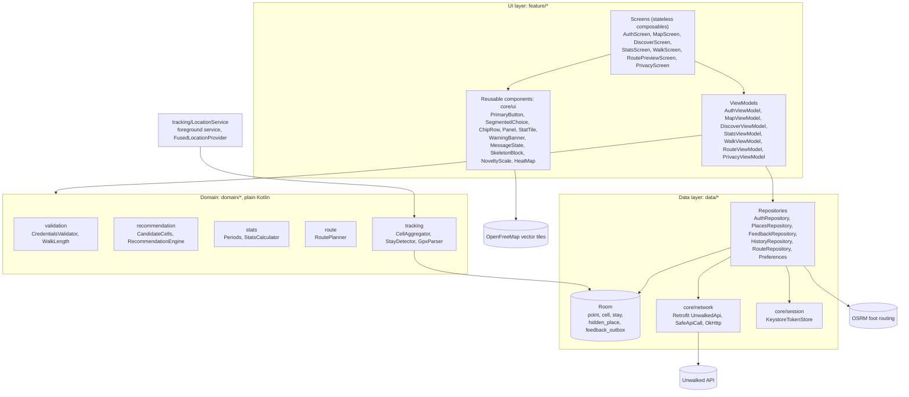

# Client architecture

Unwalked is a single-activity Android app written in Kotlin with Jetpack Compose. It follows MVVM with a unidirectional data flow: screens render an immutable UI state and send user events to a ViewModel, the ViewModel calls repositories and exposes the next state as a `StateFlow`.

## Modules and layers

| Package | Responsibility | Depends on |
|---|---|---|
| `feature/<name>` | One folder per screen: the composable, its ViewModel and its UI state | `core`, `domain`, `data` |
| `navigation` | Routes, the NavHost, the bottom bar, the global snackbar | everything in `feature` |
| `core/ui` | Theme, reusable components, the MapLibre heat map | nothing app-specific |
| `core/network` | Retrofit interface, DTOs, error mapping | `core/error`, `core/session` |
| `core/error` | `AppError`, `Outcome`, `ErrorReporter` | nothing |
| `domain` | Rules with no Android dependency: validation, novelty, stats, route planning, cell aggregation | H3 only |
| `data` | Repositories, Room, preferences | `core`, `domain` |
| `tracking` | Foreground location service, permissions, recording health | `data` |

`AppContainer` is the composition root. It creates every repository once and passes them to ViewModels through a small factory helper. A DI framework would add build time and generated code for about fifteen objects, so manual injection is the simpler choice here.

## State management

| Kind | Where | Example |
|---|---|---|
| Local UI state | `remember` / `rememberSaveable` in a composable | Password visibility, open dialogs |
| Screen state | `StateFlow<UiState>` in a ViewModel, survives rotation | The Discover list, query, filter and sort order |
| Global app state | `StateFlow` in `AppContainer` repositories | The session (`AuthRepository.session`), the active walk, the place to focus on the map, preferences |
| Global events | `SharedFlow` in `ErrorReporter` | Snackbar messages, forced sign-out |
| Persistent state | Room and encrypted preferences | Location history, hidden places, unsent feedback, the access token |

The root composable observes `session`. When it becomes `null` the app shows the sign-in flow, otherwise the main flow. Signing out anywhere therefore returns to sign-in without manual navigation.

## Routing

Navigation Compose with type-safe routes (`navigation/Routes.kt`).

| Route | Screen | Arguments |
|---|---|---|
| `SignIn`, `Register` | Sign-in and registration forms | none |
| `MapHome` | Heat map, period chips, recording banner, summary card | none |
| `Stats` | Summary for a month, a year or all time | none |
| `Walk` | Form for a walk of a set length | none |
| `RoutePreview` | Built route on the map with its numbers | `kilometres`, `shape`, `preference` |
| `Discover` | Places for you: search, category filter, sort | `focusSearch` |
| `Privacy` | Data and privacy settings, export, delete, sign out | none |

Map, Stats and Walk are bottom tabs and keep their state when switching tabs.

## API interaction

All calls go through `UnwalkedApi` (Retrofit, kotlinx.serialization). `SafeApiCall` wraps every call and turns any failure into an `Outcome.Failure` with a typed `AppError`.

| HTTP / failure | AppError | What the user sees |
|---|---|---|
| 400 with `errors` | `Validation` with field messages | The message under the matching form field |
| 401 | `Unauthorized` | Form error on sign-in, otherwise sign-out and a snackbar |
| 403 | `Forbidden` | Snackbar |
| 404 | `NotFound` | Snackbar or an empty state |
| 409 | `Conflict` | Message under the email field on registration |
| 5xx | `Server` with `traceId` | Snackbar with the code, or an error state with Try again |
| No connection, timeout | `Network` | Error state with Try again |

Problem Details bodies from the API are parsed into the same model, so the client shows the server's own message when there is one. The API itself is documented in the [backend repository](https://github.com/tuiiis/unwalked-backend/tree/main/docs/api).

## Loading and error states

Every asynchronous screen has three visual states: a skeleton while loading, the content, and a message state with a Try again button on failure. Buttons that start network work show a spinner and ignore repeated taps.
