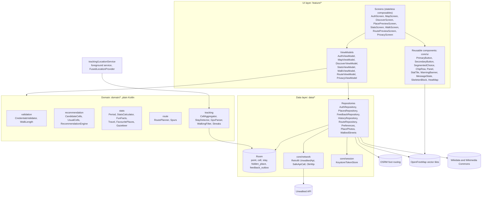

# Client architecture

Unwalked is a single-activity Android app written in Kotlin with Jetpack Compose. It follows MVVM with a unidirectional data flow: screens render an immutable UI state and send user events to a ViewModel, the ViewModel calls repositories and exposes the next state as a `StateFlow`.

## Modules and layers

| Package | Responsibility | Depends on |
|---|---|---|
| `feature/<name>` | One folder per screen: the composable, its ViewModel and its UI state | `core`, `domain`, `data` |
| `navigation` | Routes, the NavHost, the bottom bar, the global snackbar | everything in `feature` |
| `core/ui` | Theme, motion, reusable components, the MapLibre map with the walked streets layer | `data/streets` for the street network |
| `core/network` | Retrofit interface, DTOs, error mapping | `core/error`, `core/session` |
| `core/error` | `AppError`, `Outcome`, `ErrorReporter` | nothing |
| `domain` | Rules with no Android dependency: validation, novelty, stats, route planning, cell aggregation | H3 only |
| `data` | Repositories, Room, preferences, place photos, the street network read from map tiles | `core`, `domain` |
| `tracking` | Foreground location service, permissions, recording health | `data` |

`AppContainer` is the composition root. It creates every repository once and passes them to ViewModels through a small factory helper. A DI framework would add build time and generated code for about twenty objects, so manual injection is the simpler choice here.

## State management

| Kind | Where | Example |
|---|---|---|
| Local UI state | `remember` / `rememberSaveable` in a composable | Password visibility, open dialogs |
| Screen state | `StateFlow<UiState>` in a ViewModel, survives rotation | The Discover list, query, filter and sort order |
| Global app state | `StateFlow` in `AppContainer` and its repositories | The session (`AuthRepository.session`), the active walk, the walks and period shown on the map (shared with the place and route previews), preferences |
| Global events | `SharedFlow` in `ErrorReporter` | Snackbar messages, forced sign-out |
| Persistent state | Room and encrypted preferences | Location history, hidden places, unsent feedback, the access token |

The root composable observes `session`. When it becomes `null` the app shows the sign-in flow, otherwise the main flow. Signing out anywhere therefore returns to sign-in without manual navigation.

## Routing

Navigation Compose with type-safe routes (`navigation/Routes.kt`).

| Route | Screen | Arguments |
|---|---|---|
| `SignIn`, `Register` | Sign-in and registration forms | none |
| `MapHome` | Heat map, period chips, recording banner, summary card | none |
| `Stats` | Stats for a month, a quarter, a year or all time | none |
| `Walk` | Form for a walk of a set length | none |
| `RoutePreview` | Built route on the map with its numbers | `kilometres`, `shape`, `preference`, optional destination `toLat`, `toLon` |
| `Discover` | Places for you: search, category filter, sort | `focusSearch` |
| `PlacePreview` | One place on the map with its photo and a route to it | `id`, `name`, `category`, `reason`, `lat`, `lon` |
| `Privacy` | Data and privacy settings, export, delete, sign out | none |

Map, Stats and Walk are bottom tabs. Switching tabs clears the back stack above the start screen, so Back from any tab returns to the map. The map stays at the bottom of the stack, so its ViewModel and the selected period survive the switch. Back from a place preview returns to the list it was opened from.

## API interaction

All calls go through `UnwalkedApi` (Retrofit, kotlinx.serialization). `SafeApiCall` wraps every call and turns any failure into an `Outcome.Failure` with a typed `AppError`.

| HTTP / failure | AppError | What the user sees |
|---|---|---|
| 400 with `errors` | `Validation` with field messages | The message under the matching form field |
| 401 | `Unauthorized` | Form error on sign-in, otherwise sign-out and a snackbar |
| 403 | `Forbidden` | Snackbar |
| 404 | `NotFound` | Snackbar or an empty state |
| 409 | `Conflict` | Message under the email field on registration |
| 5xx | `Server` with `traceId` | Snackbar with the code, or an error state with Try again |
| No connection, timeout | `Network` | Error state with Try again |

Problem Details bodies from the API are parsed into the same model, so the client shows the server's own message when there is one. The API itself is documented in the [backend repository](https://github.com/tuiiis/unwalked-backend/tree/main/docs/api).

## Loading and error states

Every asynchronous screen has three visual states: a skeleton while loading, the content, and a message state with a Try again button on failure. Buttons that start network work show a spinner and ignore repeated taps.

## Walked streets on the map

The heat map does not draw raw GPS tracks. `WalkedStreets` reads the street network from the same vector tiles the map shows, builds a graph of it and snaps each walk to the streets it followed. Short gaps in a track are filled with the shortest path along the streets, neighbouring walks are joined by time, and lines that run side by side are pulled together so the map shows clean streets instead of noise. Parts of a walk that are far from any street, for example in a park, stay as soft blurred lines.

The result is cached in memory and on disk per set of walks, so switching the period back and forth is instant after the first time. The work runs on a background dispatcher, and the map shows a loading state when it takes longer than 150 ms.

## Place photos

`PlacePhotos` looks for a photo of the place itself. It asks Wikidata for objects within 80 m that have an image on Wikimedia Commons and accepts one only when its name matches the place. Next it searches Wikimedia Commons for photos taken within 60 m and takes one whose title matches the place, or the closest one within 25 m. If there is still none, it can fall back to a street-level photo from Mapillary when a token is configured. Results are kept on the phone, and `PhotoPrefetch` resolves and downloads photos for the top 30 recommendations in the background two seconds after the app starts, so the list usually opens with photos in place. The list shows a category icon until a photo arrives or when there is none. The credits for places and photos are at the bottom of the list.
