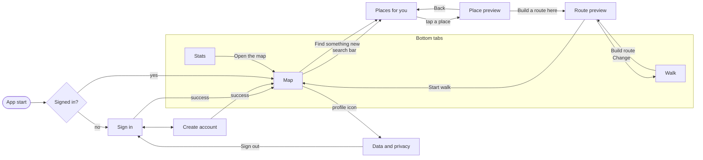

# User flows and navigation

## Navigation map

## S1. Recording stopped

1. Recording is on but the phone has not delivered a location for 25 minutes
2. The map shows an amber banner above it that pushes the map down: "Recording stopped 25 min ago"
3. If battery saver is on, the main action opens the battery saver settings. Otherwise it opens location settings
4. "Later" hides the banner until 9:00 the next morning

## S2. Place recommendation

1. The user picks a period on the map (month, quarter, year or all time) and taps "Find something new" or the search bar
2. Places for you finds the streets the user walked in that period and loads places from the API within 500 m of them, skipping cells the user has already been to. When nothing is left, Look within 1 km repeats the search with a 1 km radius
3. Each place gets a plain label instead of a score: "Overlooked" for a place the user has walked past many times, "On your way" for one right on a usual street, "Around the corner" for a short turn off it, and "Just beyond" for one a little past where the user usually turns. Best match puts the strongest labels first, Closest puts the places nearest to the usual streets first
4. The user narrows the list with the search field, a category chip or the sort order
5. "Not now" hides the place for 90 days with a five second Undo
6. Tapping a place opens its preview: the name in the search field at the top, the place on the map with the user's walks, its photo and the reason it was suggested. Back returns to the list. "Build a route here" plans a walking route from the current position to the place
7. If the user agreed to help the study, each tap sends anonymous feedback. Feedback that cannot be sent waits in an outbox and is retried with the same id

## S3. Walk of a set length

1. On the Walk tab the user sets the length with the slider or types it. A value outside 1 to 10 km or 15 min to 2 h shows an error under the field and disables Build route
2. The user chooses a loop or a different end point and whether to prefer new streets or places
3. Route preview tries eight directions, picks the one that crosses the most unvisited cells, and asks the routing service for a walking route through it
4. The preview shows length, time, new streets, new places and the share of the route that is still unwalked. "Start walk" puts the route on the map
5. If no route comes within 10% of the chosen length, the preview says "Closest route is 3.3 km" with the real length. "Use 3.3 km" accepts it, "Change" goes back to the length
6. If planning takes longer than 5 seconds, the preview says "This takes longer than usual" with "Try a shorter walk", which goes back to the length

## S4. Stats

1. The Stats tab uses the same periods as the map
2. It shows the cities and countries the walks were in, with flags and a globe, the distance walked with the next milestone, the walking pace with a playful label such as "Brisk walker", the time of day and the days of the week the user walks most, the favourite spots and the kinds of places nearby, and records such as the longest walk
3. A period without walks shows a short message and a button back to the map

## Sign in and registration

1. Fields are validated on submit, then live while the user corrects them
2. Registration needs a valid email, a password of 10 to 128 characters and the same password again
3. Server answers are mapped back to the form: a taken email under the email field, wrong credentials under the form
