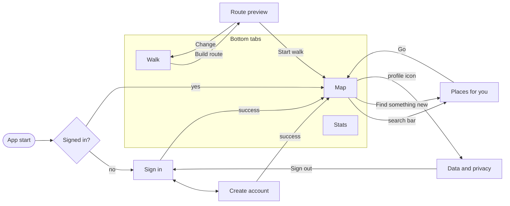

# User flows and navigation

## Navigation map

## S1. Recording stopped

1. Recording is on but the phone has not delivered a location for 25 minutes
2. The map shows an amber banner above it that pushes the map down: "Recording stopped 25 min ago"
3. If battery saver is on, the main action opens the battery saver settings. Otherwise it opens location settings
4. "Later" hides the banner until 9:00 the next morning

## S2. Place recommendation

1. On the map the user taps "Find something new" or the search bar
2. Places for you loads places from the API in cells next to the habitual ones, removes places in cells already visited, and ranks the rest by novelty
3. The user narrows the list with the search field, a category chip or the sort order
4. "Not now" hides the place for 90 days with a five second Undo. "Go" shows the place on the map
5. If the user agreed to help the study, each tap sends anonymous feedback. Feedback that cannot be sent waits in an outbox and is retried with the same id

## S3. Walk of a set length

1. On the Walk tab the user sets the length with the slider or types it. A value outside 1 to 10 km or 15 min to 2 h shows an error under the field and disables Build route
2. The user chooses a loop or a different end point and whether to prefer new streets or places
3. Route preview tries eight directions, picks the one that crosses the most unvisited cells, and asks the routing service for a walking route through it
4. The preview shows length, time, new streets, new places and the share of the route that is still unwalked. "Start walk" puts the route on the map

## Sign in and registration

1. Fields are validated on submit, then live while the user corrects them
2. Registration needs a valid email, a password of 10 to 128 characters and the same password again
3. Server answers are mapped back to the form: a taken email under the email field, wrong credentials under the form
